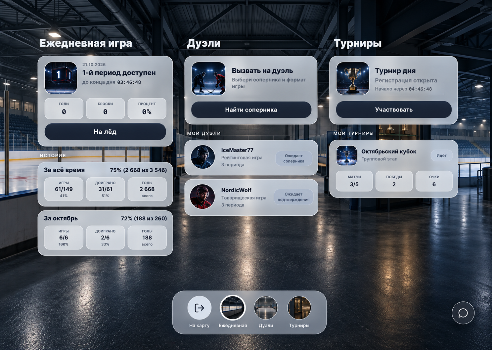
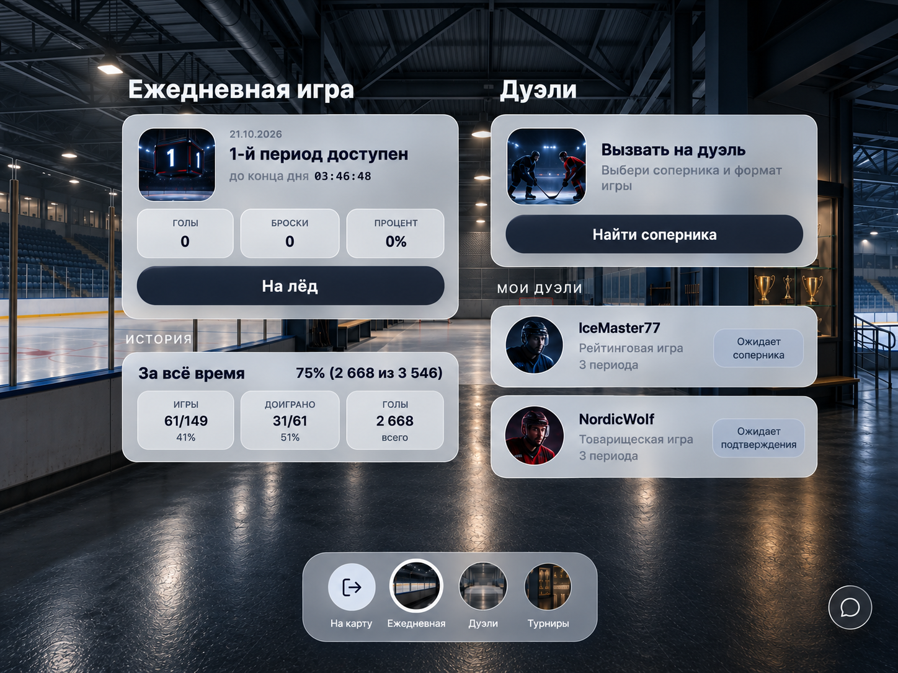

# Адаптация Ultimate Hockey для планшетов и десктопа

Дата: 21 октября 2026. Статус: спецификация для просмотра пользователем; реализация не начата.
База: `origin/dev`, `a69f34a2f98460b0dfcb22fd6f25116513a6f300`.
Ветка: `feature/responsive-wide-layout`.

## Цель и согласованный объём

Одно приложение для телефона, планшета и десктопа. По мере увеличения доступной ширины показываем соседние страницы раздела в двух или трёх колонках на общей панораме. Пользователь выбрал сразу весь объём: карта, бар, профиль, бонусные игры, стадион, задания и тренировки. Добавляем плавающий чат внутри приложения и возможность закрепить его сбоку.

Согласовано в чате: карточки сохраняют привычные размеры, нижние круги остаются общей навигацией. Подробности открываются внутри своей колонки. Запуск игры открывает отдельный игровой экран; возврат восстанавливает место. Крупные представления, например турнирная сетка, могут открываться поверх колонок.

Следующие численные размеры и поведение пограничных случаев являются предложением этой спецификации, а не ранее утверждёнными пользователем деталями.

## Визуальная основа

Это генеративные концепты компоновки. Их карточки дуэлей, турниров, имена, статусы и показатели условны. Реализация использует существующие данные, возможности и точные тексты приложения. Макеты не являются источником новых игровых функций.

Сохраняем действующие изображения, стеклянные поверхности, шрифты, круглую навигацию и основные кнопки. Общая панорама занимает фон приложения, колонки не имеют сплошных непрозрачных оболочек. Между группами карточек остаются просветы.

## Адаптивная геометрия

- При ширине до 430 CSS px сохраняем текущую мобильную геометрию и безопасные отступы.
- На большей ширине фон раскрывается на всё окно. У контента горизонтальные внешние отступы 24 px и промежутки между колонками 24 px.
- Минимальная ширина колонки 380 px, предпочтительная верхняя граница 430 px. При одной колонке её ширина ограничена 430 px; на меньших экранах она сжимается до доступного места.
- Число видимых колонок определяется шириной области раздела после вычета внешних отступов и закреплённого чата: от одной до трёх, не больше числа страниц раздела.
- При отсутствии чата две колонки становятся возможны с 832 px окна, три с 1236 px. Это исходные пороги для проверки, а не определения типов устройств.
- Оставшееся место симметрично распределяется по краям. На сверхшироких мониторах не увеличиваем число колонок сверх трёх и не растягиваем карточки.
- При недостаточной высоте работает вертикальная прокрутка; интерфейс не уменьшается целиком. Поворот планшета и изменение размера окна пересчитывают доступное место.
- У каждой колонки своя вертикальная прокрутка. Последний элемент всегда доступен над нижней панелью.
- Если страниц больше, чем помещается, горизонтальная полоса колонок перемещается. Клик на круг, стрелки и перетаскивание позволяют показать нужную страницу. Обычное колесо прокручивает колонку под указателем; работа не зависит от скрытого горизонтального жеста.
- При изменении ширины выбранная колонка остаётся видимой. Прокрутка остальных страниц сохраняется.

## Переходы и возврат

Одна общая нижняя панель показывает страницы текущего места и выход на карту. Выбранный круг выделяет активную колонку. Клик на круг подводит к колонке, которая уже видна, либо перемещает горизонтальную полосу, чтобы открыть её.

Небольшие подробности заменяют содержимое только своей колонки. Например, список дуэлей сменяется подробностями выбранной дуэли, а ежедневная игра и турниры остаются видимыми. Внутренняя кнопка «Назад» возвращает список этой колонки и прежнюю прокрутку.

Крупные подробности используют существующую модальную структуру, адаптированную по ширине. Они поддерживают закрытие, Escape, управление фокусом и возврат фокуса к инициатору. Сохраняются действующие ограничения закрытия во время незавершённого действия.

Запуск ежедневной игры, дуэли, тренировки, бонусной или барной игры убирает колонки и открывает существующее игровое представление. Логическая геометрия поля, скорости, тайминги, лимиты и правила попадания не меняются. Игровая сцена вписывается с сохранением пропорций. Перестройка поля под широкоформатный геймплей не входит в эту работу.

После штатного завершения или разрешённого выхода возвращаемся в исходное место, выбранную колонку, её подробности и сохранённую прокрутку. Новая загрузка страницы и прямая ссылка открывают нужный раздел без предварительного посещения карты. Browser Back/Forward согласованы с выбранным разделом и подробностями; смена размера окна не добавляет историю.

## Поведение по местам

| Место | Расширение |
| --- | --- |
| Карта | Показываем больше существующей панорамы при прежнем масштабе по высоте. Зоны зданий движутся вместе с изображением. Если вся карта помещается, горизонтальное перемещение прекращается. Панели выбранного места и игр остаются компактными. |
| Бар | Показываем больше интерьера и персонажей. Активен один выбранный персонаж; его панель остаётся компактной. Соседние персонажи видны и доступны. Общая нижняя навигация и привязка зон к сцене сохраняются. Игры запускаются отдельно. |
| Квартира/профиль | Соседние страницы квартиры становятся колонками: профиль, награды, друзья, настройки, сюжет. Порядок страниц, кругов и изображений согласован. Формы и подробности работают внутри соответствующей колонки. |
| Стадион | Одновременно доступны ежедневная игра, дуэли, турниры, насколько позволяет ширина. Состав страниц зависит от текущего уровня и доступа игрока, как сейчас. |
| Задания | Задания и челленджи размещаются рядом. Существующие фильтры, условия и получение наград сохраняются. Для списка внутри колонки сохраняется читаемая ширина карточки. |
| Тренировки/двор | Соседние доступные страницы тренировок становятся колонками. Внутри длинной страницы настроек и истории сохраняем связную вертикальную структуру. Недоступные режимы не становятся доступны от расширения экрана. |
| Бонусные игры | Соседние категории навыков становятся колонками; у каждой свои прогресс, список и прокрутка. Не добавляем вложенную сетку, которая уменьшает карточки. Выбранная игра открывает свои существующие подробности и затем отдельный игровой экран. |

Навигация в магазин, банк, раздевалку и зал славы не должна приводить к растянутому содержимому или поломке переходов. Пока для них не предусмотрены соседние страницы, показываем читаемую одну колонку на широком фоне. Админка, юридические страницы и вход не получают многоколоночную компоновку в рамках этой задачи.

## Чат

- На телефоне сохраняется текущий полноэкранный чат.
- При доступной ширине от 832 px кнопка чата открывает плавающее окно внутри приложения. Это не отдельное окно ОС.
- Окно имеет заголовок, переключение списка и диалога, сворачивание, закрытие, закрепление, перетаскивание и изменение размера. Управление доступно также кнопками и клавиатурой.
- Начальная ширина 360 px; размеры и положение ограничиваются текущим окном. На изменении размера и при открытии клавиатуры окно остаётся доступным.
- Закреплённый чат занимает 360 px и промежуток 24 px справа. Колонки пересчитываются по оставшемуся месту, выбранная остаётся видимой.
- Закрепление доступно, если после него помещается хотя бы одна колонка минимальной ширины с отступами. При сужении закреплённое представление автоматически становится плавающим, а ниже порога широкого чата — доступным через штатный полноэкранный маршрут.
- Во время активной игровой сцены чат автоматически сворачивается. После возврата восстанавливается прежний режим. Серверная игра не ставится на паузу из-за чата.
- Переходы между местами не закрывают плавающее окно и не стирают черновик. Открытие чата не заменяет URL основного места; прямые ссылки на чат продолжают работать.
- Используются существующие чат, авторизация, query cache и один realtime socket. Не появляются повторные отправки, подписки и независимые счётчики прочтения.
- Свёрнутый или закрытый чат не отмечает поступающие сообщения прочитанными. Чтение учитывает видимость диалога и состояние окна.
- Положение, размер и режим можно хранить локально для текущего пользователя, без содержимого сообщений. На выходе из аккаунта состояние изолируется.

## Технические границы

Сейчас `App.tsx` ограничивает оболочку 430 px; `SectionPanorama` получает только текущий `children`, а `VenuePanorama` связывает выбранный маршрут и положение фона. Значительная часть тренировок, дуэлей, турниров и игры находится в `DailyScreen.tsx`. Простое одновременное монтирование нескольких `DailyScreen` недопустимо: оно дублирует управляющую игровую логику и эффекты.

Предлагается выделить переиспользуемые представления разделов и общую оболочку колонок. Оболочка отвечает за геометрию, выбранную страницу, прокрутку и фон. Представления получают явный контекст страницы и навигации, чтобы смена URL активной колонки не переключала содержимое соседних. Общий router продолжает определять основное место, прямые ссылки и игровые маршруты.

Активные подробности и позиции хранятся по ключу пользователя, места и страницы. В URL отражается активный маршрут; состояние соседних колонок остаётся в UI-состоянии. История браузера восстанавливает активный маршрут. Полная перезагрузка восстанавливает активную ссылку; не обещаем сохранение незавершённых форм соседних колонок после перезагрузки.

Запросы используют общие существующие ключи кеша. Активная игра и её управляющие эффекты имеют единственного владельца. Скрытые за пределами горизонтального окна тяжёлые страницы можно размонтировать с сохранением UI-состояния; их медиа не должны загружаться без необходимости. Существующие охранные проверки прав и уровней действуют независимо от компоновки.

Для панорам сохраняем пропорции и единое преобразование изображения и зон нажатия. Фон не растягивается отдельно под каждую колонку. Порядок страниц и физические позиции фрагментов фона учитываются отдельно, поскольку сейчас они не всегда совпадают.

Изменения ограничены клиентом. Новые серверные API, миграции, изменения экономики и игровые правила не предполагаются. Если реализация обнаружит такую необходимость, её следует отдельно обосновать до расширения объёма.

## Проверка и критерии приёмки

1. На 390×844 и 430×932 сохраняются текущие мобильные переходы, прокрутка и доступность последних карточек.
2. На 834×1194 и 1024×768 доступны две колонки там, где есть две страницы; на 1440×1024 и 1920×1080 — до трёх. Проверяются также пороги 831/832 и 1235/1236 px.
3. Все семь мест проверяются с реальными существующими представлениями: фон, круги, активная страница и доступ совпадают. Ссылки в таблице макетов не заменяют браузерную приёмку.
4. Внутренний переход в одной колонке не сбрасывает соседнюю. Browser Back/Forward, прямая ссылка, resize и поворот экрана сохраняют согласованное состояние.
5. Ежедневная игра, дуэль, тренировка, бонусная и барная игры запускаются один раз и возвращают в исходный контекст. Покупки, награды и приглашения не выполняются повторно при появлении колонок.
6. Плавающий и закреплённый чат сохраняют основное место, черновик, корректные непрочитанные, один socket и отправку без дублей. Во время игры чат свёрнут.
7. Панорамы и зоны нажатия проверяются мышью и касанием; клавиатура и видимый фокус позволяют пользоваться навигацией и окнами. Учитываются reduced motion и безопасные отступы.
8. Для изменяемого поведения добавляются целевые тесты с наблюдаемым RED, затем GREEN. Проверяются существующие тесты SectionPanorama, маршрутов, затронутых экранов и чата; выполняются релевантные typecheck, lint и build.
9. Браузерная проверка игровых сценариев требует разрешённой тестовой сессии. Нельзя создавать/обходить авторизацию; недоступные проверки отмечаются как пробелы.
10. Локальные проверки, CI и развёрнутый dev учитываются отдельно. Деплой и изменения production этой спецификацией не разрешаются.

## Порядок дальнейшей работы

После просмотра и утверждения этой спецификации составляется конкретный план реализации: общая оболочка и навигация, выделение представлений, семь мест, чат, регрессии и браузерная приёмка. Весь согласованный объём остаётся одной задачей, даже если изменения выполняются последовательно. Начало реализации не ограничивается одним стадионом.
