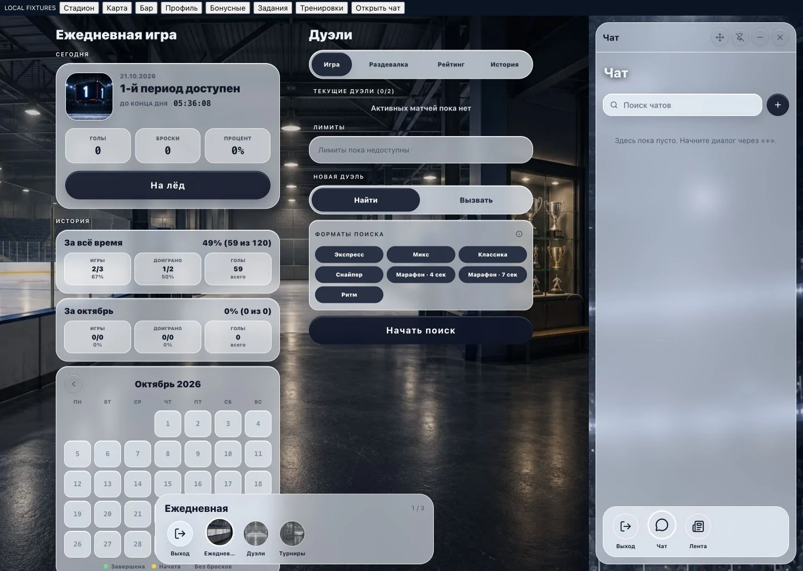

# Проверка адаптивной компоновки

Дата: 21 октября 2026. Ветка: `feature/responsive-wide-layout`.
База: `a69f34a2f98460b0dfcb22fd6f25116513a6f300`.
Проверенный коммит кода: `788d6179` (следующий коммит добавляет только этот отчёт и снимки).

## Реализованное поведение

- Карта и бар раскрывают больше панорамы на широких экранах.
- Стадион, квартира/профиль, бонусные игры, задания и тренировки используют одну, две или три соседние колонки. До 430 px работает прежний renderer мобильного маршрута.
- Подробности дуэли открываются внутри колонки без игрового контроллера. Кнопка «На лёд» переводит в отдельный игровой маршрут. История колонки и общий перехват игровых переходов сохраняют контекст возврата.
- Прокрутка независима по страницам и использует общий формат хранения для узкой и широкой компоновки.
- Чат переиспользует существующие экраны и единственное realtime-подключение App. Окно можно перемещать, менять размер, закреплять справа и сворачивать. Во время игры оно скрыто; непрочитанные не сбрасываются скрытым диалогом. Ручное сворачивание записи требует подтверждения её отмены; принудительное скрытие отменяет запись без отправки.
- PWA manifest разрешает обе ориентации: `orientation: any`.

## Локальные проверки

| Проверка | Результат |
| --- | --- |
| game-core build перед проверками потребителей | PASS |
| `pnpm typecheck` после последних изменений | PASS, все пакеты |
| `pnpm lint` после последних изменений | PASS |
| `pnpm --filter @hockey/web build` | PASS; предупреждения размера chunks и возраста Browserslist |
| Generated manifest | `orientation=any` |
| Итоговые targeted regressions | 22 файла, 211 тестов PASS |
| Full web wrapper, первая группа | 379 файлов / 3022 теста PASS; 4 файла / 9 тестов FAIL |
| Пять изолированных suites wrapper, запущены отдельно после его остановки | Все PASS: 10 + 38 + 16 + 68 + 230 тестов |
| `git diff --check` | PASS |

Последний targeted run включает обновлённый ChatRoomScreen suite: 39 тестов PASS. Число 38 выше относится к предыдущему изолированному запуску.

Полный suite не является зелёным. Девять сбоев воспроизведены на точном исходном `a69f34a2` в отдельном временном снимке, без наших изменений:

- OpenWindowObservationPlay: 5 ошибок `Stale observation scene`.
- recordedObservation: 2 ошибки `Stale observation scene`.
- ChatInfoScreen и ChannelPostCommentsScreen: по одной ошибке ожидания кнопки «Написать в личку» в profile sheet.

Логи остаются в локальном ignored ledger `.superpowers/sdd/2026-10-21-responsive-wide-layout/`: `full-web-tests-final.log`, `remaining-baseline.log`, `chatinfo-baseline.log`, `isolated-suites.log`, `acceptance-regressions-final.log`, `typecheck-final.log`, `lint-final.log`, `build-final.log`. RED/GREEN отдельных изменений сохранены там же.

## Браузерная проверка

Среда: локальный Vite, настоящие компоненты и CSS приложения, MemoryRouter, синтетические GET fixtures из существующих тестов. Любые API mutations стенда отклонялись с 405. Учётные данные и состояние авторизации не создавались и не переносились. Реальные сообщения, покупки и игровые старты не выполнялись.

Проверены и визуально просмотрены все семь мест на шести размерах. Первые мобильные снимки оказались ошибочно подписаны из-за перекрытия переключателей самого стенда баром; они заменены корректными снимками. Устранено также принудительное пересоздание компонентов при каждом переходе в стенде. Финальные контактные листы ниже содержат правильные экраны.

Порядок на каждом листе: сверху бар, бонусные игры, карта, профиль; снизу стадион, задания, тренировки. LOCAL FIXTURES сверху является панелью тестового стенда и не входит в продукт. Пустые списки и условные названия принадлежат fixtures.

| Размер | Ожидаемая компоновка | Снимки |
| --- | --- | --- |
| 390×844 | Прежняя одна мобильная страница | [Лист](assets/responsive-wide-layout/contact-390.jpg) |
| 430×932 | Прежняя одна мобильная страница | [Лист](assets/responsive-wide-layout/contact-430.jpg) |
| 834×1194 | Две колонки, карта/бар одной панорамой | [Лист](assets/responsive-wide-layout/contact-834.jpg) |
| 1024×768 | Две колонки, карта/бар одной панорамой | [Лист](assets/responsive-wide-layout/contact-1024.jpg) |
| 1440×1024 | До трёх колонок; задания — две | [Лист](assets/responsive-wide-layout/contact-1440.jpg) |
| 1920×1080 | До трёх колонок; задания — две | [Лист](assets/responsive-wide-layout/contact-1920.jpg) |

Дополнительно подтверждено в браузере:

- Пороги 831/832/1235/1236: соответственно 1/2/2/3 видимых колонки.
- Закреплённый чат на 1440×1024: x=1068, ширина 360, высота 972; справа от основной области, две видимые колонки. Высота учитывает 28 px панели стенда и отступы окна.
- Перемещение чата стрелкой клавиатуры; плавающий и закреплённый виды просмотрены.
- Настройки: черновик имени сохранился при уходе к другой колонке и возврате, затем resize 1440→834. Сохранение на сервер не выполнялось.
- Независимая прокрутка: соседняя страница осталась на 0, настройки прокручены до 719; после переключения туда и обратно осталось 719. После resize 834→390 мобильная страница восстановила 719.
- Выбор крайней страницы и уменьшение экрана сохраняют выбранную страницу.
- Все 42 основных снимка без Fixture error. Обычный viewport браузера после проверки восстановлен.

## Ревью и границы доказательств

Diff просмотрен самостоятельно без делегации: layout geometry, локальная история, игровой перехват, видимость/черновики чата, CSS specificity и readonly details. Исправлены выявленные проблемы порядка lazy imports в Vite, mobile lifecycle, ширины panorama, fixed-позиции бара и docking чата, заголовков колонок, дедупликации allowance refresh и общего хранения прокрутки. Сервер, миграции, game-core и зависимости не изменены.

Это локальная проверка синтетических сценариев. Ещё не подтверждены на авторизованном dev: реальные launch/return ежедневной игры, дуэли, тренировки, бонусной и барной игры, reconnect и реальные вложения чата. Browser Back/Forward, direct links, reduced motion и ограничения доступа покрыты целевыми тестами; полноценная приёмка на физических планшетах, touch/экранной клавиатуре и установленной PWA остаётся открытой. Сохранение незавершённых форм при переключении между мобильным и широким renderer отдельно не подтверждено.

CI для новой ветки на момент локального отчёта не проверен. Merge в dev, деплой и production не выполнялись. Временный стенд убран из product source и сохранён в ignored ledger `preview-fixtures/`; для повторного запуска его можно вернуть в `packages/web/.responsive-preview/`.
